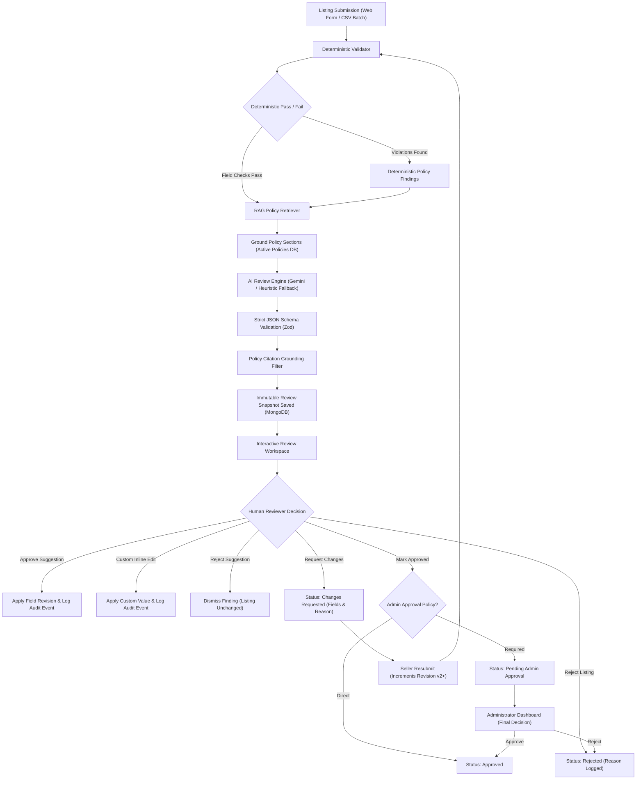
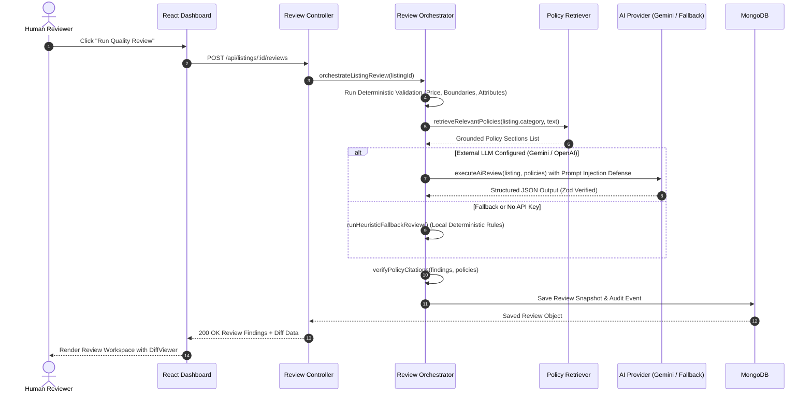
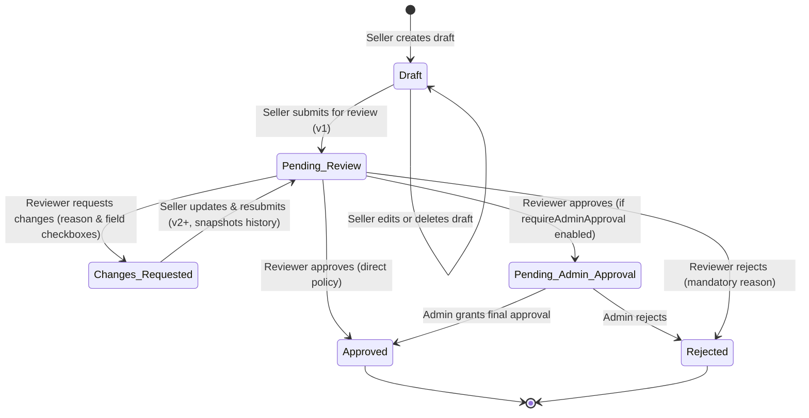

# ListingGuard — Marketplace Listing Quality & Policy Reviewer

[](https://react.dev/)
[](https://nodejs.org/)
[](https://vitejs.dev/)
[](https://tailwindcss.com/)
[](https://vitest.dev/)
[](LICENSE)

An enterprise-grade, full-stack MERN application that reviews product and service listings against active marketplace policies and brand content guidelines. It unifies a **deterministic pattern-validation engine** with **retrieval-augmented AI policy grounding (RAG)**, structured JSON schema validation, **Recharts visual analytics**, comprehensive **role-based access control (RBAC)**, and an **interactive human reviewer approval workspace**.

> [!IMPORTANT]
> **Core Marketplace Safety Invariants**:
> 1. **No Auto-Publishing**: Listings are **never** automatically published or synced to external live marketplaces.
> 2. **Human Review Invariant**: AI recommendations **never** overwrite database listing fields without explicit human reviewer authorization.
> 3. **Strict Privilege Guard**: Public registration never grants administrator privileges. Roles are strictly verified on the backend.
> 4. **Anti-Hallucination & Grounding**: Every cited policy section is cross-checked against active policy documents; ungrounded citations are demoted to unverified suggestions.

---

## Live Deployments & Demo Credentials

- **Live Backend API**: [https://marketplace-listing-reviewer-server.onrender.com](https://marketplace-listing-reviewer-server.onrender.com)
- **API Health Check**: [https://marketplace-listing-reviewer-server.onrender.com/api/health](https://marketplace-listing-reviewer-server.onrender.com/api/health)
- **Live Frontend**: [https://marketplace-listing-reviewer.onrender.com](https://marketplace-listing-reviewer.onrender.com)

### Pre-Seeded Test Accounts

The database comes pre-seeded with three organizational personas for evaluation:

| Persona / Role | Email | Password | Access Scope & Responsibilities |
| :--- | :--- | :--- | :--- |
| **System Administrator** | `admin@marketplace.local` | `AdminPass123!` | Platform oversight, User Management roster (`/users`), change user roles, suspend/activate accounts, Policy Library authoring (`/policies`), final approvals, CSV compliance reports (`/reports`), and audit logs (`/audit`). |
| **Marketplace Reviewer** | `reviewer@marketplace.local` | `ReviewerPass123!` | Audit workspace (`/reviews`), run deterministic & AI reviews, inspect policy citations, approve revisions, custom inline edit, dismiss findings, request changes with mandatory notes and field selectors, and batch reviews. |
| **Seller / Creator** | `seller@marketplace.local` | `SellerPass123!` | Create listings (`/listings/new`), save & delete drafts, view review findings and feedback notes, edit and resubmit listings (`v1 -> v2+`). *(Forbidden from reviewing, approving, or deleting catalog listings).* |

*(You can also use the registration page to self-register with any role for evaluation).*

---

## 1. System Architecture

### A. End-to-End Workflow Architecture



### B. Policy Grounding & Citation Sequence



### C. Role-Based Workflow State Machine



---

## 2. Project Directory Structure

```
listing-reviewer/
├── client/                               # Frontend (React 18 + Vite 5 + Tailwind CSS)
│   ├── public/
│   │   ├── _redirects                    # SPA redirect rules for Render static hosting
│   │   └── favicon.svg
│   ├── src/
│   │   ├── components/                   # Reusable UI component library
│   │   │   ├── DiffViewer.jsx            # Word-level visual diff with additions/deletions
│   │   │   ├── Navbar.jsx                # Top bar with role indicator, search, sync & dark mode
│   │   │   ├── Sidebar.jsx               # Navigation links tailored by user role
│   │   │   ├── SeverityBadge.jsx         # Critical / High / Medium / Low badges
│   │   │   └── StatusBadge.jsx           # Listing lifecycle state pills
│   │   ├── context/
│   │   │   ├── AuthContext.jsx           # JWT session state, login, register, logout
│   │   │   └── ThemeContext.jsx          # Dark / light theme toggle with local storage persistence
│   │   ├── layouts/
│   │   │   └── DashboardLayout.jsx       # Responsive master application shell
│   │   ├── pages/
│   │   │   ├── AuditHistoryPage.jsx      # Immutable event trail browser (/audit)
│   │   │   ├── BatchReviewPage.jsx       # CSV batch import and multi-review workspace (/batch-review)
│   │   │   ├── DashboardPage.jsx         # KPI metrics, Recharts charts, recent listing table
│   │   │   ├── ForgotPasswordPage.jsx    # Self-service password reset request
│   │   │   ├── ListingDetailPage.jsx     # Read-only product preview & revision history
│   │   │   ├── ListingFormPage.jsx       # Create/Edit listing form with currency & attribute builder
│   │   │   ├── ListingsPage.jsx          # Searchable, filterable listing catalog with sync button
│   │   │   ├── LoginPage.jsx             # Sign-in page with quick 1-click test credentials
│   │   │   ├── PolicyLibraryPage.jsx     # Policy document & section manager (/policies)
│   │   │   ├── ProfilePage.jsx           # User profile info & password change
│   │   │   ├── RegisterPage.jsx          # Self-service account registration
│   │   │   ├── ReportsPage.jsx           # Analytics charts and CSV export triggers (/reports)
│   │   │   ├── ResetPasswordPage.jsx     # Token-based password update page
│   │   │   ├── ReviewWorkspacePage.jsx   # AI audit workspace with diffs, findings & approval buttons
│   │   │   ├── SettingsPage.jsx          # Platform settings (categories, admin approval policy)
│   │   │   └── UserManagementPage.jsx    # Admin user management roster (/users)
│   │   ├── services/
│   │   │   └── api.js                    # Axios instance with auth interceptor & URL resolution
│   │   └── utils/
│   │       └── currency.js               # Currency symbols (USD $, INR ₹, EUR €, GBP £) & formatters
│   ├── index.html                        # Application entry HTML
│   ├── package.json                      # Frontend dependencies & scripts
│   ├── tailwind.config.js                # Tailwind CSS design system configuration
│   └── vite.config.js                    # Vite configuration with IPv4 dev proxy & vendor chunking
│
├── server/                               # Backend (Node.js + Express + Mongoose + Vitest)
│   ├── src/
│   │   ├── config/
│   │   │   ├── config.js                 # Environment variable loader & defaults
│   │   │   └── db.js                     # MongoDB connection with reconnect handlers
│   │   ├── controllers/
│   │   │   ├── auditController.js        # Audit log querying and filtering
│   │   │   ├── authController.js         # JWT registration, authentication, password reset
│   │   │   ├── batchController.js        # CSV parsing, batch review orchestration
│   │   │   ├── dashboardController.js    # Metric aggregations for KPIs & chart statistics
│   │   │   ├── listingController.js      # CRUD, drafts, revisions, submission & resubmission
│   │   │   ├── policyController.js       # Policy document and section CRUD
│   │   │   ├── reportController.js       # CSV exports (listings, reviews) and analytics
│   │   │   ├── reviewController.js       # 12-step review trigger, inline edit, dismiss, approvals
│   │   │   └── userController.js         # Administrator user roster management
│   │   ├── middleware/
│   │   │   ├── auth.js                   # JWT bearer token verification
│   │   │   ├── errorHandler.js           # Centralized JSON error response handler
│   │   │   ├── roles.js                  # RBAC authorization guards (requireRole)
│   │   │   └── validate.js               # Zod request payload validation middleware
│   │   ├── models/
│   │   │   ├── AuditEvent.js             # Immutable audit log entries
│   │   │   ├── BatchJob.js               # Batch CSV import jobs & summary states
│   │   │   ├── Listing.js                # Listing schema, revision tracking, attributes & currency
│   │   │   ├── PolicyDocument.js         # Policy document definitions
│   │   │   ├── PolicySection.js          # Clause-level policy sections with citation codes
│   │   │   ├── Review.js                 # Review snapshots, findings, revisions, turnaround times
│   │   │   ├── Setting.js                # System settings (categories, requireAdminApproval)
│   │   │   └── User.js                   # Users, bcrypt passwords, roles, status
│   │   ├── routes/                       # Express route routers
│   │   ├── services/
│   │   │   ├── ai/
│   │   │   │   ├── aiProvider.js         # Unified AI dispatcher (Gemini / OpenAI / Heuristic)
│   │   │   │   ├── heuristicFallback.js  # 100% offline deterministic rule engine
│   │   │   │   ├── outputSchema.js       # Strict Zod schema for structured AI outputs
│   │   │   │   └── promptBuilder.js      # Prompt injection-resistant prompt assembler
│   │   │   ├── audit/
│   │   │   │   └── auditLogger.js        # Structured audit event persistence
│   │   │   ├── policy/
│   │   │   │   └── policyRetriever.js    # RAG policy section retriever
│   │   │   ├── validation/
│   │   │   │   └── deterministicValidator.js # Field boundaries, prices, duplicate detection
│   │   │   └── reviewOrchestrator.js     # 12-step review orchestration pipeline
│   │   ├── utils/
│   │   │   ├── attributeNormalizer.js    # Attribute auto-splitting, normalization, text formatting
│   │   │   └── seed.js                   # Initial policy clauses and default demo accounts
│   │   ├── app.js                        # Express app initialization, Helmet, CORS, routes
│   │   └── server.js                     # HTTP server startup bound to 0.0.0.0
│   ├── tests/                            # Automated test suite (Vitest + Supertest)
│   │   ├── auth.test.js                  # Registration, JWT, password security, RBAC guards
│   │   ├── policy.test.js                # Policy authoring, section indexing, RAG retrieval
│   │   ├── review.test.js                # Orchestration, revisions, inline edits, resubmissions
│   │   ├── setup.js                      # MongoMemoryServer in-memory DB test lifecycle
│   │   └── validation.test.js            # Boundary tests, currency, negative price, attributes
│   └── package.json                      # Backend dependencies, Vitest configuration & scripts
│
├── .env.example                          # Environment variable template (no real secrets)
├── AGENT_USAGE.md                        # Documentation of AI assistance, prompts & verification
├── LICENSE                               # MIT License
└── README.md                             # Documentation & Setup Guide
```

---

## 3. Functional Scope & Feature Highlights

### A. Role-Based Access Control (RBAC)
- **Three Core Personas**:
  - **Seller**: Creates listings, manages drafts, fixes requested changes, and resubmits (`v1 -> v2+`). Forbidden from reviewing, approving, or deleting catalog listings.
  - **Reviewer**: Evaluates submitted listings, runs AI reviews, inspects policy citations, approves revisions, dismisses false findings, or requests changes.
  - **Administrator**: Complete system governance, user management (`/users`), policy authoring (`/policies`), final approvals, and audit trail inspection.
- **Dedicated User Profile**: Accessible via the top avatar pill (`/profile`), displays user role badge, account status, and password update form.
- **Administrator Roster Management (`/users`)**: Search, filter, modify roles, and toggle user active/suspended status with real-time feedback.

### B. Listing Form Validation & Product Attributes
- **Title Validation**: Required, 5 to 150 characters, trimmed, rejects whitespace-only strings.
- **Description Validation**: Required, minimum 20 characters, rejects whitespace-only strings.
- **Category Validation**: Validated against active allowed categories; placeholder `"Select Category"` is strictly rejected on both frontend and backend.
- **Price Validation**: Must be greater than 0, numeric, maximum 2 decimal places. HTML validation is supplemented by strict backend Zod and Mongoose schema checks.
- **Multi-Currency Support**: Includes USD (`$`), INR (`₹`), EUR (`€`), and GBP (`£`) with universal formatting.
- **Product Attributes Normalizer**:
  - Automatically detects colon-separated strings (e.g. `"Dimensions: 65 x 65 x 110 cm"` pasted into the key box) and splits them into `{ key: "Dimensions", value: "65 x 65 x 110 cm" }`.
  - Rejects empty keys, empty values, and duplicate keys case-insensitively.
  - Generates clean human-readable text representations (never `"[object Map]"`).

### C. Seller Actions & Revision Tracking
- **Save Draft**: Allows incomplete drafts while enforcing basic data types and ownership. Sellers can edit and delete their own drafts. Deleting submitted listings is forbidden (403 Forbidden).
- **Submit for Review**: Runs strict field validation. On success, transitions status to `Pending Review`.
- **Resubmit Listing**: When changes are requested, the seller updates the flagged fields and clicks "Resubmit for Review". The backend snapshots the existing listing state into `revisionHistory`, increments `revision` (`v1 -> v2`), sets `resubmittedAt`, and transitions status back to `Pending Review`.

### D. Human Review Workspace & Word-Level DiffViewer
- **Word-Level Visual Diffs**: Highlights additions (`bg-emerald-100`) and deletions (`bg-rose-100`).
- **Granular Actions**: Single-click **Approve Suggestion**, **Edit Before Approving**, or **Dismiss Finding**.
- **Request Changes**: Interactive modal requiring both a clear textual reason and checkboxes selecting which fields require correction (`title`, `description`, `category`, `price`, `currency`, `attributes`).
- **Mark Approved**: Verifies that no blocking critical findings remain, checks organizational policy (`requireAdminApproval`), and transitions to either `Approved` or `Pending Admin Approval`.
- **Reject Listing**: Requires a mandatory rejection reason and updates status to `Rejected`.
- **Batch Processing Workspace (`/batch-review`)**: Multi-listing review orchestration, CSV listing import, and pre-flight validation.

### E. Analytics & Authorized CSV Exports
- **Recharts Visualizations**: Interactive Donut/Pie chart for listing compliance status and Bar chart for violation severities.
- **CSV Data Export (`/reports`)**:
  - `GET /api/reports/export-listings`: Full listing catalog export.
  - `GET /api/reports/export-reviews`: Detailed policy violation audit findings with citations and timestamps.

### F. Theme System & Real-Time Synchronization
- Complete Dark & Light mode toggle with class-based persistence in `localStorage` and `document.documentElement`.
- Dashboards auto-refresh via 20-second polling and include a manual **Sync** button in the header.

---

## 4. Technology Stack

| Layer | Technologies |
|---|---|
| **Frontend** | React 18, Vite 5.4, Tailwind CSS 3.4, React Router v6, Axios, Lucide React, Recharts |
| **Backend** | Node.js (v18+), Express.js 4, Mongoose 8, JWT with HTTP-only cookies, bcryptjs, Zod 4, Helmet, CORS, Express Rate Limit |
| **AI & Grounding** | Official Google Generative AI SDK (`@google/generative-ai`), OpenAI REST API fallback, Heuristic Pattern Matcher fallback |
| **Testing** | Vitest 5, Supertest, MongoDB Memory Server |
| **Cloud Hosting** | Render (Web Service & Static Site), MongoDB Atlas (M0 Shared Cluster) |

---

## 5. Setup Instructions Step by Step for VSCode

### Step 1: Open Project in VSCode
1. Launch Visual Studio Code.
2. Select **File > Open Folder...** and choose `listing-reviewer`.
3. Open the integrated terminal (`Ctrl + \`` or **Terminal > New Terminal**).

### Step 2: Install Dependencies
Run from the root directory:
```bash
npm install
npm --prefix server install
npm --prefix client install
```

### Step 3: Configure Environment Variables
1. Copy the provided `.env.example` file to create your server `.env`:
   ```bash
   cp .env.example server/.env
   ```
2. Verify or update `server/.env`:
   ```env
   PORT=5000
   NODE_ENV=development
   CLIENT_ORIGIN=http://localhost:5173
   MONGODB_URI=mongodb://127.0.0.1:27017/marketplace_quality_reviewer
   JWT_SECRET=your_super_secret_jwt_key_at_least_32_characters
   LLM_PROVIDER=gemini
   GEMINI_API_KEY=
   ```
   *(Leaving `GEMINI_API_KEY` blank automatically activates the deterministic fallback engine).*

### Step 4: Seed Initial Marketplace Policies & Accounts
Initialize the database with default test accounts, categories, and policy clauses:
```bash
npm run seed
```

### Step 5: Run the Development Stack
Start both backend and frontend concurrently from the root terminal:
```bash
npm run dev
```
Or start each service separately in two terminals:
- **Terminal 1 (Backend)**:
  ```bash
  cd server
  npm run dev
  ```
- **Terminal 2 (Frontend)**:
  ```bash
  cd client
  npm run dev
  ```

### Step 6: Access the Application
Open your browser to:
```
http://localhost:5173
```
Log in using one of the pre-seeded accounts:
- **Admin**: `admin@marketplace.local` / `AdminPass123!`
- **Reviewer**: `reviewer@marketplace.local` / `ReviewerPass123!`
- **Seller**: `seller@marketplace.local` / `SellerPass123!`

---

## 6. Automated Testing

The project includes an end-to-end integration and unit test suite covering authentication, authorization, deterministic validators, policy grounding, human review workflows, and React UI components.

### Run All Backend Tests (26 tests across 4 suites):
```bash
npm --prefix server test
```

Test coverage breakdown:
- **`server/tests/auth.test.js`**: User registration, login, role assignment, token generation, and authorization guards.
- **`server/tests/review.test.js`**: 12-step review execution, AI and rule findings generation, human approval of revisions, inline custom edit approval, suggestion rejection, resubmission with revision tracking, and audit trail logging.
- **`server/tests/validation.test.js`**: Required field enforcement, negative price rejection, title/description boundaries, colon-separated attribute normalization, placeholder category rejection, and duplicate similarity detection.
- **`server/tests/policy.test.js`**: RAG policy retrieval, grounding verification, and anti-hallucination citation checks.

### Production Build Verification:
```bash
npm --prefix client run build
```
Executes Vite production compilation and builds client assets into `client/dist`.

---

## 7. Limitations & System Constraints

1. **No External Marketplace Publishing**:
   - The platform deliberately does **not** push listings to real live marketplace channels (e.g., Amazon, eBay, Shopify). It serves strictly as a pre-publication compliance, moderation, and quality assurance gate.
2. **Deterministic Fallback Boundary**:
   - When external LLM API keys are absent or network requests time out (20s limit), the system falls back to the deterministic pattern matcher. While comprehensive for prohibited terms, extreme claims, and required field anomalies, nuanced contextual semantics benefit from configuring a live Gemini API key.
3. **Similarity Detection False Positives**:
   - Near-duplicate detection uses token-based Jaccard overlap and Levenshtein distance. Highly standardized listings (e.g., replacement cables, standard size variations) may trigger duplicate warnings; these are explicitly flagged as advisory disclaimers for reviewer discretion.
4. **Batch Processing Sizing Limits**:
   - Batch reviews are capped at 50 items per job (`MAX_BATCH_SIZE=50`) to maintain browser responsiveness and prevent backend memory spikes during CSV parsing.
5. **Free Cloud Tier Cold Starts**:
   - When hosted on Render's free tier, the backend web service spins down after 15 minutes of inactivity. Initial requests may take 30–50 seconds to wake the service.

---

## 8. Cloud Deployment Guide (Render & MongoDB Atlas)

### A. Deploy Backend Web Service on Render
1. In the Render Dashboard, click **New + > Web Service**.
2. Select your repository (`marketplace-listing-reviewer`).
3. Set the following parameters:
   - **Root Directory**: `server`
   - **Environment**: `Node`
   - **Build Command**: `npm install`
   - **Start Command**: `npm start`
   - **Instance Type**: `Free` ($0/month)
4. Add Environment Variables under the **Environment** tab:
   - `NODE_ENV`: `production`
   - `PORT`: `10000`
   - `MONGODB_URI`: `mongodb+srv://<user>:<password>@cluster0.xxxxx.mongodb.net/listing_reviewer?retryWrites=true&w=majority`
   - `JWT_SECRET`: `listingguard_super_secure_jwt_token_secret_key_32_chars`
   - `CLIENT_ORIGIN`: `https://marketplace-listing-reviewer.onrender.com`
   - `LLM_PROVIDER`: `gemini`
   - `GEMINI_API_KEY`: *(Optional: leave blank for deterministic fallback, or provide Google AI Studio key)*
5. Click **Create Web Service**.

### B. Deploy Frontend Static Site on Render
1. In the Render Dashboard, click **New + > Static Site**.
2. Select your repository (`marketplace-listing-reviewer`).
3. Set the following parameters:
   - **Root Directory**: `client`
   - **Build Command**: `npm install && npm run build`
   - **Publish Directory**: `dist`
4. Add Environment Variable:
   - `VITE_API_BASE_URL`: `https://marketplace-listing-reviewer-server.onrender.com/api`
5. Click **Create Static Site**.
*(The included `client/public/_redirects` file automatically handles SPA routing rewrites).*

---

## 9. REST API Reference

| Method | Endpoint | Description | Role / Auth |
| :--- | :--- | :--- | :--- |
| `GET` | `/` | API welcome banner and service status | Public |
| `GET` | `/api/health` | Health check & MongoDB connection status | Public |
| `POST` | `/api/auth/register` | Register new account (Reviewer, Seller, Admin) | Public (Rate-limited) |
| `POST` | `/api/auth/login` | Authenticate and obtain JWT cookie & token | Public (Rate-limited) |
| `POST` | `/api/auth/logout` | Invalidate cookie and session | Authenticated |
| `GET` | `/api/auth/me` | Retrieve currently authenticated user | Authenticated |
| `PATCH` | `/api/auth/profile` | Update profile details and theme | Authenticated |
| `POST` | `/api/auth/change-password` | Update user password | Authenticated |
| `POST` | `/api/auth/forgot-password` | Request password reset token | Public |
| `POST` | `/api/auth/reset-password/:token` | Complete password reset with token | Public |
| `GET` | `/api/dashboard/stats` | Aggregated catalog & review metrics | Authenticated |
| `GET` | `/api/listings` | Search, filter, and paginate listings | Authenticated |
| `POST` | `/api/listings` | Create listing (Draft / Pending) | Authenticated |
| `GET` | `/api/listings/:id` | View listing details and reviews | Authenticated |
| `PATCH` | `/api/listings/:id` | Update listing content | Owner / Admin / Reviewer |
| `DELETE` | `/api/listings/:id` | Delete listing (Sellers: drafts only) | Owner / Admin |
| `POST` | `/api/listings/:id/duplicate` | Duplicate listing as draft | Authenticated |
| `PATCH` | `/api/listings/:id/archive` | Toggle archived status | Authenticated |
| `PATCH` | `/api/listings/:id/assign` | Assign review task to reviewer | Admin / Reviewer |
| `POST` | `/api/listings/:id/request-changes` | Send changes requested note & fields to seller | Admin / Reviewer |
| `PATCH` | `/api/listings/:id/resubmit` | Fix & resubmit listing (bumps revision) | Listing Owner / Seller |
| `POST` | `/api/listings/:id/reviews` | Trigger 12-step quality review | Reviewer / Admin |
| `GET` | `/api/reviews/:id` | Get review findings & diffs | Authenticated |
| `POST` | `/api/reviews/:id/approve` | Final review approval (or mark Pending Admin) | Reviewer / Admin |
| `POST` | `/api/reviews/:id/reject` | Final review rejection with mandatory reason | Reviewer / Admin |
| `POST` | `/api/reviews/:id/revisions/:findingId/approve` | Approve suggestion & update listing | Reviewer / Admin |
| `POST` | `/api/reviews/:id/revisions/:findingId/reject` | Dismiss/reject individual finding | Reviewer / Admin |
| `PATCH` | `/api/reviews/:id/revisions/:findingId` | Inline edit suggestion & apply custom text | Reviewer / Admin |
| `POST` | `/api/reviews/:id/approve-all` | Approve all eligible revisions | Reviewer / Admin |
| `GET` | `/api/reports/analytics` | Aggregated platform compliance stats | Authenticated |
| `GET` | `/api/reports/export-listings` | Export listing catalog as CSV | Admin Only |
| `GET` | `/api/reports/export-reviews` | Export audit findings as CSV | Admin Only |
| `GET` | `/api/reports/system` | System diagnostics & AI provider status | Admin Only |
| `GET` | `/api/users` | List all platform users | Admin Only |
| `PATCH` | `/api/users/:id/role` | Modify member role | Admin Only |
| `PATCH` | `/api/users/:id/status` | Suspend or activate member | Admin Only |
| `GET` | `/api/policies` | List marketplace policy documents | Authenticated |
| `POST` | `/api/policies` | Create policy document | Admin Only |
| `POST` | `/api/policies/:id/sections` | Add section with unique code | Admin Only |
| `POST` | `/api/batches/upload` | Validate CSV and return preview | Reviewer / Admin |
| `POST` | `/api/batches/import` | Import CSV rows & review in batch | Reviewer / Admin |
| `GET` | `/api/audit` | Query immutable audit log | Reviewer / Admin |

---

## 10. License

This project is licensed under the MIT License — see the [LICENSE](LICENSE) file for details.
