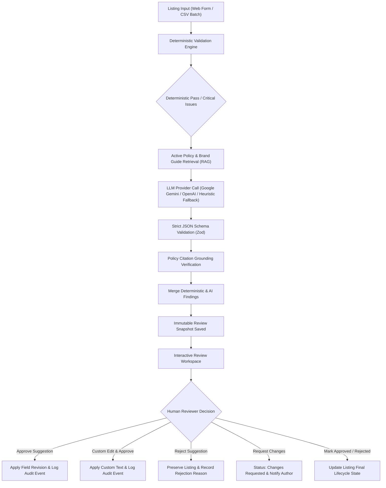
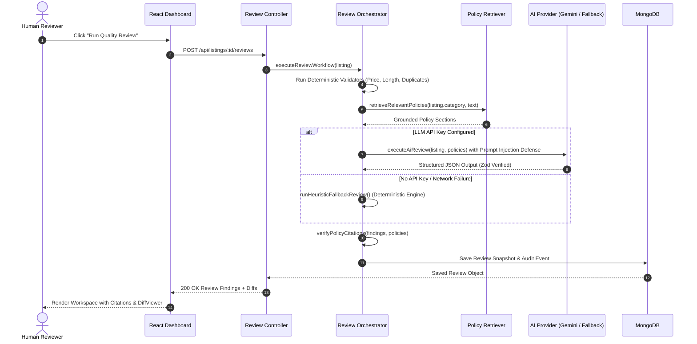

# ListingGuard — Marketplace Listing Quality & Policy Reviewer

[](https://react.dev/)
[](https://nodejs.org/)
[](https://vitejs.dev/)
[](https://tailwindcss.com/)
[](https://vitest.dev/)
[](LICENSE)

An enterprise-grade, full-stack MERN application that reviews product and service listings against active marketplace policies and brand content guidelines. It unifies a **deterministic pattern-validation engine** with **retrieval-augmented AI policy grounding (RAG)**, structured JSON schema validation, **Recharts visual analytics**, comprehensive **role-based access control (RBAC)**, and an **interactive human reviewer approval workspace**.

> [!IMPORTANT]
> **Core Marketplace Safety Invariants**:
> 1. **No Auto-Publishing**: Listings are **never** automatically published or synced to external live marketplaces.
> 2. **Human Review Invariant**: AI recommendations **never** overwrite database listing fields without explicit human reviewer authorization.
> 3. **Strict Privilege Guard**: Public registration never grants administrator privileges. Roles are strictly verified on the backend.
> 4. **Anti-Hallucination & Grounding**: Every cited policy section is cross-checked against active policy documents; ungrounded citations are demoted to unverified suggestions.

---

## Live Deployments & Demo Credentials

- **Live Backend API**: [https://marketplace-listing-reviewer-server.onrender.com](https://marketplace-listing-reviewer-server.onrender.com)
- **API Health Check**: [https://marketplace-listing-reviewer-server.onrender.com/api/health](https://marketplace-listing-reviewer-server.onrender.com/api/health)
- **Live Frontend**: [https://marketplace-listing-reviewer.onrender.com](https://marketplace-listing-reviewer.onrender.com)

### Pre-Seeded Test Accounts

The database comes pre-seeded with three organizational personas for evaluation:

| Persona / Role | Email | Password | Access Scope & Responsibilities |
| :--- | :--- | :--- | :--- |
| **System Administrator** | `admin@marketplace.local` | `AdminPass123!` | Platform oversight, User Management roster (`/users`), change user roles, suspend/activate accounts, Policy Library authoring (`/policies`), CSV compliance reports (`/reports`), and audit logs (`/audit`). |
| **Marketplace Reviewer** | `reviewer@marketplace.local` | `ReviewerPass123!` | Audit workspace (`/reviews`), run deterministic & AI reviews, inspect policy citations, approve revisions, custom inline edit, reject suggestions, request changes with mandatory notes, and batch reviews. |
| **Seller / Creator** | `seller@marketplace.local` | `SellerPass123!` | Create listings (`/listings/new`), manage drafts, view review findings and feedback notes, edit and resubmit listings. *(Forbidden from reviewing, approving, or deleting catalog listings).* |

*(You can also use the registration page to self-register with any of the 3 roles for testing).*

---

## 1. System Architecture

### A. End-to-End Workflow Architecture



### B. Policy Grounding & Citation Sequence



---

## 2. Functional Scope & Feature Highlights

### A. Role-Based Access Control (RBAC)
- **Role Verification on Server**: Every protected endpoint enforces `protect` and `authorize(...)` middleware. Roles submitted during public registration are sanitized and validated.
- **Dedicated User Profile**: Accessible from the top navigation avatar pill (`/profile`), displays initials, email, assigned role badge, account status, and password change form.
- **Administrator Roster Management (`/users`)**: Search, filter, modify roles, and toggle user active/suspended status with real-time feedback.

### B. Deterministic Validation & Duplicate Engine
- **Field Constraints**: Validates required fields (`title`, `description`, `category`, `price`, `seller`), positive numeric pricing, supported currencies, title bounds (10–150 chars), and description bounds (30–5000 chars).
- **Duplicate & Near-Duplicate Detection**: Evaluates Jaccard token overlap and normalized Levenshtein similarity against existing listings in the database, surfacing warnings with explicit false-positive disclaimers.

### C. Retrieval-Augmented Policy Grounding & Safety
- **RAG Policy Matching**: Retrieves policy clauses based on category relevancy and keyword indexing.
- **Prompt Injection Defense**: Encapsulates user listing content inside strict `<listing_data>` XML boundaries and explicitly instructs the model to ignore instructions contained in seller data.
- **Anti-Hallucination Code Gate**: Verifies every AI-produced citation section ID against active database policies. Hallucinated codes are demoted to `unverified recommendation`.
- **Zero-Key Deterministic Fallback**: Operates with 100% functionality without requiring external API keys.

### D. Human Review Workspace & Word-Level DiffViewer
- **Side-by-Side Diff Comparison**: Word-level visual diff highlighting additions (`bg-emerald-100`) and deletions (`bg-rose-100`).
- **Granular Actions**: Single-click **Approve Suggestion**, **Edit Before Approving**, or **Reject Suggestion**.
- **Request Changes Flow**: Reviewers request changes with mandatory notes; sellers receive clear feedback and can **Fix & Resubmit**.
- **Batch Processing Workspace (`/batch-review`)**: Multi-listing review orchestration, CSV listing import, and pre-flight validation.

### E. Analytics & Authorized CSV Exports
- **Recharts Visualizations**: Interactive Donut/Pie chart for listing compliance status and Bar chart for violation severities.
- **CSV Data Export (`/reports`)**:
  - `GET /api/reports/export-listings`: Full listing catalog export.
  - `GET /api/reports/export-reviews`: Detailed policy violation audit findings with citations and timestamps.

### F. Theme System
- Complete Dark & Light mode toggle with class-based persistence in `localStorage` and `document.documentElement`, synchronized across all components.

---

## 3. Technology Stack

| Layer | Technologies |
|---|---|
| **Frontend** | React 18, Vite 5.4, Tailwind CSS 3.4, React Router v6, Axios, React Hook Form, Lucide React, Recharts |
| **Backend** | Node.js (v18+), Express.js 4, Mongoose 8, JWT with HTTP-only cookies, bcryptjs, Zod 4, Helmet, CORS, Express Rate Limit |
| **AI & Grounding** | Official Google Generative AI SDK (`@google/generative-ai`), OpenAI REST API fallback, Heuristic Pattern Matcher fallback |
| **Testing** | Vitest 3, Supertest, React Testing Library, jsdom, MongoDB Memory Server |
| **Cloud Hosting** | Render (Web Service & Static Site), MongoDB Atlas (M0 Shared Cluster) |

---

## 4. Setup Instructions Step by Step for VSCode

### Step 1: Open Project in VSCode
1. Launch Visual Studio Code.
2. Select **File > Open Folder...** and choose the project directory:
   ```bash
   listing-reviewer
   ```
3. Open the integrated terminal (`Ctrl + \`` or **Terminal > New Terminal**).

### Step 2: Install Dependencies
Run from the root directory:
```bash
npm install
npm --prefix server install
npm --prefix client install
```

### Step 3: Configure Environment Variables
1. Copy the provided `.env.example` file to create your server `.env`:
   ```bash
   cp .env.example server/.env
   ```
2. Verify or update `server/.env`:
   ```env
   PORT=5000
   NODE_ENV=development
   CLIENT_ORIGIN=http://localhost:5173
   MONGODB_URI=mongodb://127.0.0.1:27017/marketplace_quality_reviewer
   JWT_SECRET=your_super_secret_jwt_key_at_least_32_characters
   LLM_PROVIDER=gemini
   GEMINI_API_KEY=
   ```
   *(Leaving `GEMINI_API_KEY` blank automatically activates the deterministic fallback engine).*

3. Verify `client/.env.production` (or create `client/.env` if pointing to a custom backend):
   ```env
   VITE_API_BASE_URL=/api
   ```

### Step 4: Seed Initial Marketplace Policies & Accounts
Initialize the database with default test accounts, categories, and policy clauses:
```bash
npm run seed
```

### Step 5: Run the Development Stack
Run both frontend and backend concurrently from the root terminal:
```bash
npm run dev
```
Or start each service separately:
- Backend: `npm --prefix server run dev` (Port 5000)
- Frontend: `npm --prefix client run dev` (Port 5173)

### Step 6: Access the Application
Open your browser to:
```
http://localhost:5173
```
Log in using one of the pre-seeded accounts:
- **Admin**: `admin@marketplace.local` / `AdminPass123!`
- **Reviewer**: `reviewer@marketplace.local` / `ReviewerPass123!`
- **Seller**: `seller@marketplace.local` / `SellerPass123!`

---

## 5. Automated Testing

The project includes an end-to-end integration and unit test suite covering authentication, authorization, deterministic validators, policy grounding, human review workflows, and React UI components.

### Run All Backend Tests (18 tests across 4 suites):
```bash
npm run test:server
```
Test coverage breakdown:
- **`server/tests/auth.test.js`**: User registration, login, role assignment, token generation, and authorization guards.
- **`server/tests/review.test.js`**: 12-step review execution, AI and rule findings generation, human approval of revisions, inline custom edit approval, suggestion rejection, and audit trail logging.
- **`server/tests/validation.test.js`**: Required field enforcement, negative price rejection, title/description boundaries, and duplicate similarity detection.
- **`server/tests/policy.test.js`**: RAG policy retrieval, grounding verification, and anti-hallucination citation checks.

### Run All Frontend Component Tests:
```bash
npm run test:client
```
Verifies `SeverityBadge`, `StatusBadge`, `DiffViewer`, and modal interactions.

### Production Build Verification:
```bash
npm run build
```
Executes Vite production compilation and builds client assets into `client/dist`.

---

## 6. Limitations & System Constraints

1. **No External Marketplace Publishing**:
   - The platform deliberately does **not** push listings to real live marketplace channels (e.g., Amazon, eBay, Shopify). It serves strictly as a pre-publication compliance, moderation, and quality assurance gate.
2. **Deterministic Fallback Boundary**:
   - When external LLM API keys are absent or network requests time out (20s limit), the system falls back to the deterministic pattern matcher. While comprehensive for prohibited terms, extreme claims, and required field anomalies, nuanced contextual semantics benefit from configuring a live Gemini API key.
3. **Similarity Detection False Positives**:
   - Near-duplicate detection uses token-based Jaccard overlap and Levenshtein distance. Highly standardized listings (e.g., replacement cables, standard size variations) may trigger duplicate warnings; these are explicitly flagged as advisory disclaimers for reviewer discretion.
4. **Batch Processing Sizing Limits**:
   - Batch reviews are capped at 50 items per job (`MAX_BATCH_SIZE=50`) to maintain browser responsiveness and prevent backend memory spikes during CSV parsing.
5. **Free Cloud Tier Cold Starts**:
   - When hosted on Render's free tier, the backend web service spins down after 15 minutes of inactivity. Initial requests may take 30–50 seconds to wake the service.

---

## 7. Cloud Deployment Guide (Render & MongoDB Atlas)

### A. Deploy Backend Web Service on Render
1. In the Render Dashboard, click **New + > Web Service**.
2. Select your repository (`marketplace-listing-reviewer`).
3. Set the following parameters:
   - **Root Directory**: `server`
   - **Environment**: `Node`
   - **Build Command**: `npm install`
   - **Start Command**: `npm start`
   - **Instance Type**: `Free` ($0/month)
4. Add Environment Variables under the **Environment** tab:
   - `NODE_ENV`: `production`
   - `PORT`: `10000`
   - `MONGODB_URI`: `mongodb+srv://<user>:<password>@cluster0.xxxxx.mongodb.net/listing_reviewer?retryWrites=true&w=majority`
   - `JWT_SECRET`: `listingguard_super_secure_jwt_token_secret_key_32_chars`
   - `CLIENT_ORIGIN`: `https://marketplace-listing-reviewer.onrender.com`
   - `LLM_PROVIDER`: `gemini`
   - `GEMINI_API_KEY`: *(Optional: leave blank for deterministic fallback, or provide Google AI Studio key)*
5. Click **Create Web Service**.

### B. Deploy Frontend Static Site on Render
1. In the Render Dashboard, click **New + > Static Site**.
2. Select your repository (`marketplace-listing-reviewer`).
3. Set the following parameters:
   - **Root Directory**: `client`
   - **Build Command**: `npm install && npm run build`
   - **Publish Directory**: `dist`
4. Add Environment Variable:
   - `VITE_API_BASE_URL`: `https://marketplace-listing-reviewer-server.onrender.com/api`
5. Click **Create Static Site**.
*(The included `client/public/_redirects` file automatically handles SPA routing rewrites).*

---

## 8. REST API Reference

| Method | Endpoint | Description | Role / Auth |
| :--- | :--- | :--- | :--- |
| `GET` | `/` | API welcome banner and service status | Public |
| `GET` | `/api/health` | Health check & MongoDB connection status | Public |
| `POST` | `/api/auth/register` | Register new account (Reviewer, Seller, Admin) | Public (Rate-limited) |
| `POST` | `/api/auth/login` | Authenticate and obtain JWT cookie & token | Public (Rate-limited) |
| `POST` | `/api/auth/logout` | Invalidate cookie and session | Authenticated |
| `GET` | `/api/auth/me` | Retrieve currently authenticated user | Authenticated |
| `PATCH` | `/api/auth/profile` | Update profile details and theme | Authenticated |
| `POST` | `/api/auth/change-password` | Update user password | Authenticated |
| `POST` | `/api/auth/forgot-password` | Request password reset token | Public |
| `POST` | `/api/auth/reset-password/:token` | Complete password reset with token | Public |
| `GET` | `/api/dashboard/stats` | Aggregated catalog & review metrics | Authenticated |
| `GET` | `/api/listings` | Search, filter, and paginate listings | Authenticated |
| `POST` | `/api/listings` | Create listing (Draft / Pending) | Authenticated |
| `GET` | `/api/listings/:id` | View listing details and reviews | Authenticated |
| `PATCH` | `/api/listings/:id` | Update listing content | Owner / Admin / Reviewer |
| `DELETE` | `/api/listings/:id` | Delete listing | Admin / Reviewer |
| `POST` | `/api/listings/:id/duplicate` | Duplicate listing as draft | Authenticated |
| `PATCH` | `/api/listings/:id/archive` | Toggle archived status | Authenticated |
| `PATCH` | `/api/listings/:id/assign` | Assign review task to reviewer | Admin / Reviewer |
| `POST` | `/api/listings/:id/request-changes` | Send changes requested note to seller | Admin / Reviewer |
| `PATCH` | `/api/listings/:id/resubmit` | Fix & resubmit listing after changes | Listing Owner / Seller |
| `POST` | `/api/listings/:id/reviews` | Trigger 12-step quality review | Reviewer / Admin |
| `GET` | `/api/reviews/:id` | Get review findings & diffs | Authenticated |
| `PATCH` | `/api/reviews/:id/decision` | Mark Approved, Rejected, or Changes Requested | Reviewer / Admin |
| `POST` | `/api/reviews/:id/revisions/:findingId/approve` | Approve suggestion & update listing | Reviewer / Admin |
| `POST` | `/api/reviews/:id/revisions/:findingId/reject` | Reject suggestion with reason | Reviewer / Admin |
| `PATCH` | `/api/reviews/:id/revisions/:findingId` | Inline edit suggestion & apply custom text | Reviewer / Admin |
| `POST` | `/api/reviews/:id/approve-all` | Approve all eligible revisions | Reviewer / Admin |
| `GET` | `/api/reports/analytics` | Aggregated platform compliance stats | Authenticated |
| `GET` | `/api/reports/export-listings` | Export listing catalog as CSV | Admin Only |
| `GET` | `/api/reports/export-reviews` | Export audit findings as CSV | Admin Only |
| `GET` | `/api/reports/system` | System diagnostics & AI provider status | Admin Only |
| `GET` | `/api/users` | List all platform users | Admin Only |
| `PATCH` | `/api/users/:id/role` | Modify member role | Admin Only |
| `PATCH` | `/api/users/:id/status` | Suspend or activate member | Admin Only |
| `GET` | `/api/policies` | List marketplace policy documents | Authenticated |
| `POST` | `/api/policies` | Create policy document | Admin Only |
| `POST` | `/api/policies/:id/sections` | Add section with unique code | Admin Only |
| `POST` | `/api/batches/upload` | Validate CSV and return preview | Reviewer / Admin |
| `POST` | `/api/batches/import` | Import CSV rows & review in batch | Reviewer / Admin |
| `GET` | `/api/audit` | Query immutable audit log | Reviewer / Admin |

---

## 9. License

This project is licensed under the MIT License — see the [LICENSE](LICENSE) file for details.
