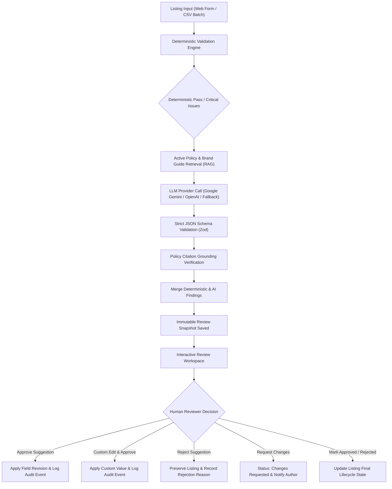

# ListingGuard — Marketplace Listing Quality & Policy Reviewer

A full-stack, enterprise-grade MERN system that reviews product and service listings against marketplace policies and brand content guidelines. It pairs a **deterministic validation engine** with **retrieval-augmented AI policy grounding (RAG)**, structured JSON schema validation, **Recharts visual analytics**, **role-based access control (RBAC)**, and an **interactive human reviewer approval workspace**.

> [!IMPORTANT]
> The system strictly adheres to marketplace safety controls: **listings are never automatically published to a live marketplace**, and **AI suggestions never overwrite listing fields without explicit human reviewer approval**. Public registration never grants administrator privileges.

---

## 1. Key Capabilities & Workflow Architecture



### A. Enterprise Role-Based Access Control (RBAC)
- **Administrator**: Full platform oversight, user management (`/users`), user role changes, account suspension/activation, policy library authoring (`/policies`), system & AI diagnostics (`/settings`), compliance reports with CSV exports (`/reports`), and audit trail (`/audit`).
- **Reviewer**: Audits listings, runs AI-assisted and rule-based validation, compares original vs suggested revisions, approves/rejects suggestions, requests changes with mandatory revision notes, assigns reviews, batch reviews.
- **Seller / Listing Creator**: Submits listings, manages drafts, views compliance findings and reviewer feedback notes, updates listings, and resubmits for review. *Strictly forbidden from reviewing, approving, rejecting, or deleting catalog listings.*

### B. Deterministic Validation Engine
- Evaluates data using ordinary, deterministic code before/alongside AI review.
- Checks required fields (`title`, `description`, `category`, `price`, `seller`).
- Validates price format (strictly positive numeric, supported currency codes, upper platform threshold).
- Enforces configurable title length (10–150 chars) and description length (30–5000 chars).
- Validates categories against configurable supported categories list.
- Checks flexible attribute key-values for completeness and malformed objects.
- Validates optional tags formatting and max counts.
- **Duplicate & Near-Duplicate Detection**: Evaluates token-based Jaccard and normalized Levenshtein similarity against existing database listings with explicit false-positive disclaimers.

### C. Retrieval-Augmented AI Policy Grounding & Citation Verification
- Retrieves active policy clauses from `PolicySection` based on category relevance and keyword token scoring.
- Prompts configured LLM (Google Gemini / OpenAI) using **prompt injection defense**:
  - Encloses listing content in strict `<listing_data>` boundaries.
  - Instructs model that listing content is untrusted seller data, not system instructions.
- Enforces strict structured JSON schema via Zod.
- **Policy Citation Verification**: Checks every AI-generated `policySectionId` against actual retrieved active policy sections. If a citation was hallucinated, it is stripped and demoted to an `unverified recommendation`.
- **Deterministic Heuristic Fallback**: If the AI provider key is unset or external API fails, the backend seamlessly switches to pattern-matching heuristic checks (prohibited terms, medical miracles, guarantee hype, ALL CAPS shouting) with zero downtime and explicit metadata indicating fallback was used.

### D. Human Review & Approval Workspace
- Side-by-side / diff comparison between original and proposed wording.
- Single-click **Approve Suggestion**, **Edit Before Approving**, or **Reject Suggestion**.
- **Request Changes**: Enables reviewers to send listings back to sellers with mandatory remediation reasons.
- Batch **Approve All Eligible Revisions** with explicit confirmation dialog.
- Re-run quality review on demand.
- Append-only immutable audit trail recording every change, before/after snapshots, reviewer identity, and timestamp.

### E. Analytics, Reporting & CSV Export
- Interactive **Recharts** visualizations:
  - Donut / Pie chart: Listing catalog compliance status distribution.
  - Bar chart: Policy violations by severity level (Critical, High, Medium, Low).
- Authorized CSV exports:
  - **Export Listings CSV** (`/api/reports/export-listings`): Full catalog with pricing, category, status, and seller.
  - **Export Audit Findings CSV** (`/api/reports/export-reviews`): Detailed policy violations, citations, severity, and timestamps.
- System diagnostics: Database connectivity, AI provider status, API key verification, and uptime.

---

## 2. Technology Stack

- **Frontend**: React.js (Vite), Tailwind CSS (Dark/Light themes), React Router v6, Axios, React Hook Form, Lucide React icons, Recharts data visualization.
- **Backend**: Node.js, Express.js, MongoDB with Mongoose, JWT authentication with secure HTTP-only cookies and bcrypt password hashing, Zod schema validation, Multer, Helmet, CORS, Express Rate Limit.
- **AI Integration**: Google Generative AI (`@google/generative-ai`), OpenAI REST API fallback, and deterministic rule-engine fallback.
- **Testing**: Vitest, Supertest, React Testing Library, jsdom, MongoDB Memory Server.

---

## 3. Directory Structure

```
listing-reviewer/
├── client/                     # Vite + React Frontend
│   ├── src/
│   │   ├── components/         # SeverityBadge, StatusBadge, DiffViewer, Modal, Navbar, Sidebar
│   │   ├── context/            # AuthContext (JWT session, RBAC, theme state)
│   │   ├── layouts/            # MainLayout
│   │   ├── pages/              # Dashboard, Listings, ListingForm, ReviewWorkspace, Policies,
│   │   │                       # Batch, Audit, Settings, Profile, UserManagement, Reports,
│   │   │                       # ForgotPassword, ResetPassword, Login, Register
│   │   ├── services/           # Axios API client with interceptors
│   │   └── test/               # React Testing Library unit tests
│   ├── index.html
│   ├── tailwind.config.js
│   └── vite.config.js
├── server/                     # Node.js + Express Backend
│   ├── src/
│   │   ├── config/             # DB & environment configuration
│   │   ├── controllers/        # Auth, Listing, Review, Policy, Batch, Audit, User, Report
│   │   ├── middleware/         # Auth, Roles, Zod Validation, RateLimiter, ErrorHandler
│   │   ├── models/             # User, Listing, PolicyDocument, PolicySection, Review, AuditEvent, BatchJob, Setting
│   │   ├── routes/             # RESTful API route definitions
│   │   ├── services/           # Deterministic Validator, Policy Retriever, AI Provider, Heuristic Fallback, Orchestrator
│   │   └── utils/              # Seed data generator & String similarity algorithms
│   ├── tests/                  # Vitest + Supertest integration tests (Auth, Policy, Review, Validation)
│   └── vitest.config.js
├── .vscode/                    # VSCode workspace debug configurations
│   └── launch.json
├── package.json                # Monorepo root scripts (dev, test, build)
├── .env.example                # Environment variable template
├── render.yaml                 # Render Blueprint configuration for free 1-click cloud deploy
├── AGENT_USAGE.md              # AI Agent transparency & prompt audit log
└── README.md                   # Full documentation & setup guide
```

---

## 4. Setup Instructions Step by Step for VSCode

Follow these exact steps to set up and run the project inside Visual Studio Code:

### Step 1: Clone or Open in VSCode
1. Open Visual Studio Code.
2. Select **File > Open Folder...** and choose the project directory:
   ```
   c:\Users\singh\OneDrive\Desktop\listing-reviewer
   ```
3. Open the integrated terminal in VSCode (`Ctrl + \`` or **Terminal > New Terminal**).

### Step 2: Install Recommended VSCode Extensions (Optional but Recommended)
- **ESLint** (`dbaeumer.vscode-eslint`)
- **Prettier - Code formatter** (`esbenp.prettier-vscode`)
- **Tailwind CSS IntelliSense** (`bradlc.vscode-tailwindcss`)

### Step 3: Configure Environment Variables
1. In the VSCode terminal, copy the `.env.example` file to create your server `.env`:
   ```bash
   cp .env.example server/.env
   ```
2. Verify or customize values in `server/.env`:
   - `PORT=5000`
   - `MONGODB_URI=mongodb://127.0.0.1:27017/marketplace_quality_reviewer` (or your MongoDB Atlas connection string)
   - `JWT_SECRET=your_super_secret_jwt_key_at_least_32_characters`
   - `LLM_PROVIDER=gemini` (leave `GEMINI_API_KEY` blank to test with the deterministic fallback, or supply a key to test external AI).

### Step 4: Install Dependencies
Run the install command in the root terminal:
```bash
npm install
npm --prefix server install
npm --prefix client install
```

### Step 5: Seed Sample Marketplace Policies & Accounts
Initialize the database with default test users, categories, policies, and sample listings:
```bash
npm run seed
```

### Step 6: Run & Debug in VSCode

#### Option A: One-Click VSCode Debugger (F5)
1. Click the **Run and Debug** icon on the VSCode Activity Bar (`Ctrl + Shift + D`).
2. Select **"Run Full Dev Stack (Concurrent)"** from the dropdown and press **F5** (or click the green Play button).
3. Both backend (port 5000) and frontend (port 5173) will start up automatically in your VSCode integrated terminal.

#### Option B: Terminal Command
Alternatively, run directly from the VSCode terminal:
```bash
npm run dev
```

### Step 7: Access the Application
Open your browser to:
```
http://localhost:5173
```

### Default Pre-Seeded Accounts:
| Role | Email | Password | Permissions |
| :--- | :--- | :--- | :--- |
| **Administrator** | `admin@marketplace.local` | `AdminPass123!` | Full admin access, User roster, Reports, Settings |
| **Reviewer** | `reviewer@marketplace.local` | `ReviewerPass123!` | Audit workspace, approve/reject, request changes |
| **Seller** | `seller@marketplace.local` | `SellerPass123!` | Submit listings, view status, fix & resubmit |

---

## 5. Live Free Permanent Hosting Instructions

You can host this project permanently for free using **Render** (free Web Service tier) paired with **MongoDB Atlas** (free M0 Sandbox cluster).

### Free Architecture Overview:
- **Web Service Host**: [Render.com](https://render.com) (Free Tier: 750 free instance hours/month, continuous deployment from GitHub).
- **Database**: [MongoDB Atlas](https://www.mongodb.com/cloud/atlas) (Free M0 Shared Cluster: 512 MB storage, always free).
- **Serving Model**: The Node.js Express backend serves both the `/api/*` REST endpoints and the compiled React production frontend from `client/dist` under a single free domain.

### Step-by-Step Free Deployment:

#### Step 1: Create a Free MongoDB Atlas Database
1. Go to [mongodb.com/cloud/atlas](https://www.mongodb.com/cloud/atlas) and sign up for a free account.
2. Create a new free cluster (**M0 Sandbox**, AWS or GCP region closest to you).
3. In **Database Access**, create a database user (e.g., `listingguard-admin`) with a secure password.
4. In **Network Access**, click **Add IP Address** and select **Allow Access from Anywhere (`0.0.0.0/0`)**.
5. Click **Connect > Drivers (Node.js)** and copy your connection string:
   ```
   mongodb+srv://listingguard-admin:<password>@cluster0.abcde.mongodb.net/marketplace?retryWrites=true&w=majority
   ```

#### Step 2: Push Your Code to GitHub
1. Create a new repository on your GitHub account (e.g. `marketplace-listing-reviewer`).
2. Push your project to GitHub:
   ```bash
   git add .
   git commit -m "feat: complete enterprise marketplace listing reviewer"
   git remote add origin https://github.com/<your-username>/marketplace-listing-reviewer.git
   git push -u origin main
   ```

#### Step 3: Deploy to Render (Free Web Service)
1. Sign up or log in to [render.com](https://render.com).
2. Click **New + > Web Service**.
3. Connect your GitHub repository.
4. Configure the service settings:
   - **Name**: `listingguard-marketplace-reviewer`
   - **Region**: Oregon (US West) or Frankfurt (EU)
   - **Runtime**: `Node`
   - **Branch**: `main`
   - **Build Command**:
     ```bash
     npm run build:prod
     ```
   - **Start Command**:
     ```bash
     npm start
     ```
   - **Instance Type**: `Free`
5. Click **Advanced > Add Environment Variable**:
   | Key | Value |
   | :--- | :--- |
   | `NODE_ENV` | `production` |
   | `PORT` | `10000` |
   | `MONGODB_URI` | `mongodb+srv://<user>:<password>@cluster0.abcde.mongodb.net/marketplace?retryWrites=true&w=majority` |
   | `JWT_SECRET` | *(Click "Generate" or paste a random 32-character string)* |
   | `LLM_PROVIDER` | `gemini` |
   | `GEMINI_API_KEY` | *(Optional: your Gemini API key, or leave blank to use fallback)* |
6. Click **Create Web Service**.

#### Step 4: Verification & Live Link
Render will automatically:
1. Run `npm run build:prod` (installs backend and frontend dependencies and compiles `client/dist`).
2. Run `npm start` which boots the server and auto-seeds initial data on first boot.
3. Provide your permanently active public URL:
   ```
   https://listingguard-marketplace-reviewer.onrender.com
   ```
You can verify the deployment status at any time via:
```
https://listingguard-marketplace-reviewer.onrender.com/api/health
```

---

## 6. Running Automated Tests

### Run All Backend Tests (18 tests across 4 test suites):
```bash
npm run test:server
```
Covers:
- **`auth.test.js`**: User signup, login, password confirmation, role validation, reviewer restrictions on policies.
- **`review.test.js`**: 12-step review execution, AI and rule findings, human approval of suggestions, custom edit before approval, rejection workflows, audit log events.
- **`validation.test.js`**: Deterministic validation bounds, missing required fields, negative prices, duplicate detection algorithms.
- **`policy.test.js`**: Retrieval-augmented grounding and anti-hallucination citation checks.

### Run All Frontend Tests:
```bash
npm run test:client
```
Covers:
- SeverityBadge rendering
- StatusBadge rendering
- DiffViewer comparison
- Modal interactions

### Production Build Verification:
```bash
npm run build
```
Compiles and bundles the client into `client/dist`.

---

## 7. REST API Contract Summary

| Method | Endpoint | Description | Role / Auth |
| :--- | :--- | :--- | :--- |
| `POST` | `/api/auth/register` | Register new reviewer or seller | Public (Rate-limited) |
| `POST` | `/api/auth/login` | Login and receive JWT cookie & token | Public (Rate-limited) |
| `POST` | `/api/auth/logout` | Invalidate cookie / session | Public |
| `GET` | `/api/auth/me` | Fetch currently authenticated user | Authenticated |
| `PATCH` | `/api/auth/profile` | Update display name, department, theme | Authenticated |
| `POST` | `/api/auth/change-password` | Update user password | Authenticated |
| `POST` | `/api/auth/forgot-password` | Request password reset token | Public |
| `POST` | `/api/auth/reset-password/:token` | Complete token-based password reset | Public |
| `GET` | `/api/health` | Service health & MongoDB status | Public |
| `GET` | `/api/dashboard/stats` | Aggregated catalog & review metrics | Authenticated |
| `GET` | `/api/listings` | Search, filter, paginate listings | Authenticated |
| `POST` | `/api/listings` | Create listing (Draft / Pending) | Authenticated |
| `GET` | `/api/listings/:id` | View listing details and reviews | Authenticated |
| `PATCH` | `/api/listings/:id` | Update listing content | Owner / Admin / Reviewer |
| `DELETE` | `/api/listings/:id` | Delete listing | Admin / Reviewer |
| `POST` | `/api/listings/:id/duplicate` | Duplicate listing as draft | Authenticated |
| `PATCH` | `/api/listings/:id/archive` | Toggle archived status | Authenticated |
| `PATCH` | `/api/listings/:id/assign` | Assign review task to reviewer | Admin / Reviewer |
| `POST` | `/api/listings/:id/request-changes` | Send changes requested back to author | Admin / Reviewer |
| `PATCH` | `/api/listings/:id/resubmit` | Fix & resubmit listing after changes | Listing Owner / Seller |
| `POST` | `/api/listings/:id/reviews` | Trigger 12-step quality review | Reviewer / Admin |
| `GET` | `/api/reviews/:id` | Get review findings & diffs | Authenticated |
| `PATCH` | `/api/reviews/:id/decision` | Mark Approved, Rejected, or Changes Requested | Reviewer / Admin |
| `POST` | `/api/reviews/:id/revisions/:findingId/approve` | Approve suggestion & update listing | Reviewer / Admin |
| `POST` | `/api/reviews/:id/revisions/:findingId/reject` | Reject suggestion with reason | Reviewer / Admin |
| `PATCH` | `/api/reviews/:id/revisions/:findingId` | Edit suggestion & apply custom text | Reviewer / Admin |
| `POST` | `/api/reviews/:id/approve-all` | Approve all eligible revisions | Reviewer / Admin |
| `GET` | `/api/reports/analytics` | Aggregated platform compliance stats | Authenticated |
| `GET` | `/api/reports/export-listings` | Export listings catalog as CSV | Admin Only |
| `GET` | `/api/reports/export-reviews` | Export audit findings as CSV | Admin Only |
| `GET` | `/api/reports/system` | System diagnostics & AI provider status | Admin Only |
| `GET` | `/api/users` | List all platform members | Admin Only |
| `POST` | `/api/users` | Create new platform user | Admin Only |
| `PATCH` | `/api/users/:id/role` | Change member role | Admin Only |
| `PATCH` | `/api/users/:id/status` | Suspend or activate member | Admin Only |
| `GET` | `/api/users/reviewers` | List active reviewers for assignment | Admin / Reviewer |
| `GET` | `/api/policies` | List policy documents & sections | Authenticated |
| `POST` | `/api/policies` | Create policy document | Admin Only |
| `POST` | `/api/policies/:id/sections` | Add section with unique code | Admin Only |
| `GET` | `/api/policies/settings` | Get categories & thresholds | Authenticated |
| `PATCH` | `/api/policies/settings` | Update categories & thresholds | Admin Only |
| `POST` | `/api/batches/upload` | Validate CSV and return preview | Reviewer / Admin |
| `POST` | `/api/batches/import` | Import CSV rows & review in batch | Reviewer / Admin |
| `POST` | `/api/batches` | Batch review selected listing IDs | Reviewer / Admin |
| `GET` | `/api/audit` | Query immutable audit log | Reviewer / Admin |

---

## 8. Enterprise Security & Invariants Checklist

- [x] **No Auto-Publishing**: Approved listings never interact with external marketplace publisher APIs.
- [x] **Human Review Invariant**: AI suggestions never alter database listing fields without explicit human reviewer authorization.
- [x] **Strict Privilege Guard**: Public registration sanitizes any attempt to claim `administrator` role.
- [x] **Anti-Hallucination Guard**: Every cited policy section is cross-checked against actual retrieved policy documents.
- [x] **Prompt Injection Immunity**: Untrusted seller content is strictly isolated within XML-style `<listing_data>` tags.
- [x] **Resilient Fallback**: Operates with 100% feature coverage even when external LLM providers are offline.
