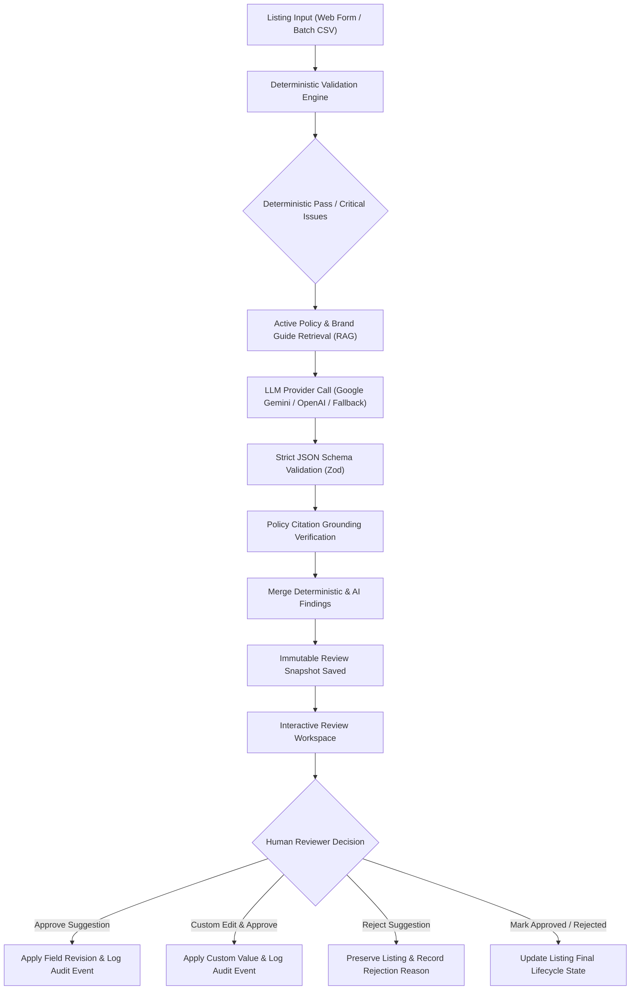

# ListingGuard — Marketplace Listing Quality & Policy Reviewer

A full-stack, enterprise-grade system that reviews product and service listings against marketplace policies and brand content guidelines. It pairs a **deterministic validation engine** with **retrieval-augmented AI policy grounding (RAG)**, structured JSON schema validation, and an **interactive human reviewer approval workspace**.

> [!IMPORTANT]
> The system strictly adheres to marketplace safety controls: **listings are never automatically published to a live marketplace**, and **AI suggestions never overwrite listing fields without explicit human reviewer approval**.

---

## 1. Key Capabilities & Workflow Architecture



### A. Deterministic Validation Engine
- Evaluates data using ordinary, deterministic code before/alongside AI review.
- Checks required fields (`title`, `description`, `category`, `price`, `seller`).
- Validates price format (strictly positive numeric, supported currency codes, upper platform threshold).
- Enforces configurable title length (10–150 chars) and description length (30–5000 chars).
- Validates categories against configured supported categories list.
- Checks flexible attribute key-values for completeness and malformed objects.
- Validates optional tags formatting and max counts.
- **Duplicate & Near-Duplicate Detection**: Evaluates token-based Jaccard and normalized Levenshtein similarity against existing database listings with explicit false-positive disclaimers.

### B. Retrieval-Augmented AI Policy Grounding & Citation Verification
- Retrieves active policy clauses from `PolicySection` based on category relevance and keyword token scoring.
- Prompts configured LLM (Google Gemini / OpenAI) using **prompt injection defense**:
  - Encloses listing content in strict `<listing_data>` boundaries.
  - Instructs model that listing content is untrusted seller data, not system instructions.
- Enforces strict structured JSON schema via Zod.
- **Policy Citation Verification**: Checks every AI-generated `policySectionId` against actual retrieved active policy sections. If a citation was hallucinated, it is stripped and demoted to an `unverified recommendation`.
- **Deterministic Heuristic Fallback**: If the AI provider key is unset or external API fails, the backend seamlessly switches to pattern-matching heuristic checks (prohibited terms, medical miracles, guarantee hype, ALL CAPS shouting) with zero downtime and explicit metadata indicating fallback was used.

### C. Human Review & Approval Workspace
- Side-by-side / diff comparison between original and proposed wording.
- Single-click **Approve Suggestion**, **Edit Before Approving**, or **Reject Suggestion**.
- Batch **Approve All Eligible Revisions** with explicit confirmation dialog.
- Re-run quality review on demand.
- Append-only immutable audit trail recording every change, before/after snapshots, reviewer identity, and timestamp.

---

## 2. Technology Stack

- **Frontend**: React.js (Vite), Tailwind CSS, React Router v6, Axios, React Hook Form, Lucide React icons.
- **Backend**: Node.js, Express.js, MongoDB with Mongoose, JWT authentication with bcrypt password hashing, Zod schema validation, Multer, Helmet, CORS, Express Rate Limit.
- **AI Integration**: Google Generative AI (`@google/generative-ai`), OpenAI REST API fallback, and deterministic rule-engine fallback.
- **Testing**: Vitest, Supertest, React Testing Library, jsdom, MongoDB Memory Server.

---

## 3. Directory Structure

```
listing-reviewer/
├── client/                     # Vite + React Frontend
│   ├── src/
│   │   ├── components/         # SeverityBadge, StatusBadge, DiffViewer, Modal, Navbar, Sidebar
│   │   ├── context/            # AuthContext (JWT session management)
│   │   ├── layouts/            # MainLayout
│   │   ├── pages/              # Dashboard, Listings, ListingForm, ReviewWorkspace, Policies, Batch, Audit, Settings
│   │   ├── services/           # Axios API client
│   │   └── test/               # React Testing Library unit tests
│   ├── index.html
│   ├── tailwind.config.js
│   └── vite.config.js
├── server/                     # Node.js + Express Backend
│   ├── src/
│   │   ├── config/             # DB & environment configuration
│   │   ├── controllers/        # Auth, Listing, Review, Policy, Batch, Audit controllers
│   │   ├── middleware/         # Auth, Roles, Zod Validation, RateLimiter, ErrorHandler
│   │   ├── models/             # User, Listing, PolicyDocument, PolicySection, Review, AuditEvent, BatchJob, Setting
│   │   ├── routes/             # RESTful API route definitions
│   │   ├── services/           # Deterministic Validator, Policy Retriever, AI Provider, Heuristic Fallback, Orchestrator
│   │   └── utils/              # Seed data generator & String similarity algorithms
│   ├── tests/                  # Vitest + Supertest integration tests
│   └── vitest.config.js
├── package.json                # Monorepo root scripts (dev, test, build)
├── .env.example                # Environment variable template
├── AGENT_USAGE.md              # AI Agent transparency & prompt audit log
└── README.md                   # Full documentation & setup guide
```

---

## 4. REST API Contract Summary

| Method | Endpoint | Description | Role / Auth |
| :--- | :--- | :--- | :--- |
| `POST` | `/api/auth/register` | Register new reviewer or admin | Public (Rate-limited) |
| `POST` | `/api/auth/login` | Login and receive JWT cookie & token | Public (Rate-limited) |
| `POST` | `/api/auth/logout` | Invalidate cookie / session | Public |
| `GET` | `/api/auth/me` | Fetch currently authenticated user | Authenticated |
| `GET` | `/api/health` | Service health & MongoDB status | Public |
| `GET` | `/api/dashboard/stats` | Aggregated catalog & review metrics | Authenticated |
| `GET` | `/api/listings` | Search, filter, paginate listings | Authenticated |
| `POST` | `/api/listings` | Create listing (Draft / Pending) | Authenticated |
| `GET` | `/api/listings/:id` | View listing details and reviews | Authenticated |
| `PATCH` | `/api/listings/:id` | Update listing content | Owner / Admin |
| `DELETE` | `/api/listings/:id` | Delete listing | Owner / Admin |
| `POST` | `/api/listings/:id/reviews` | Trigger 12-step quality review | Authenticated |
| `GET` | `/api/reviews/:id` | Get review findings & diffs | Authenticated |
| `POST` | `/api/reviews/:id/revisions/:findingId/approve` | Approve suggestion & update listing | Authenticated |
| `POST` | `/api/reviews/:id/revisions/:findingId/reject` | Reject suggestion with reason | Authenticated |
| `PATCH` | `/api/reviews/:id/revisions/:findingId` | Edit suggestion & apply custom text | Authenticated |
| `POST` | `/api/reviews/:id/approve-all` | Approve all eligible revisions | Authenticated |
| `POST` | `/api/reviews/:id/approve` | Mark overall review Approved | Authenticated |
| `POST` | `/api/reviews/:id/reject` | Mark overall review Rejected | Authenticated |
| `GET` | `/api/policies` | List policy documents & sections | Authenticated |
| `POST` | `/api/policies` | Create policy document | Admin Only |
| `POST` | `/api/policies/:id/sections` | Add section with unique code | Admin Only |
| `GET` | `/api/policies/settings` | Get categories & thresholds | Authenticated |
| `PATCH` | `/api/policies/settings` | Update categories & thresholds | Admin Only |
| `POST` | `/api/batches/upload` | Validate CSV and return preview | Authenticated |
| `POST` | `/api/batches/import` | Import CSV rows & review in batch | Authenticated |
| `POST` | `/api/batches` | Batch review selected listing IDs | Authenticated |
| `POST` | `/api/batches/:id/retry` | Retry failed batch records | Authenticated |
| `GET` | `/api/audit` | Query immutable audit log | Authenticated |

---

## 5. Local Setup & Execution Instructions

### Prerequisites
- Node.js `v18+` or `v20+` (tested with Node `v24.12.0`)
- npm `v9+` or `v11+`
- MongoDB local instance or MongoDB Atlas URI (Note: automated tests use an embedded MongoDB memory server and require no external DB configuration).

### Step 1: Install Dependencies
Run from the root directory:
```bash
npm install
npm --prefix server install
npm --prefix client install
```

### Step 2: Environment Configuration
Create a `.env` file in the root or `server/` directory from `.env.example`:
```bash
cp .env.example server/.env
```
Key variables:
- `PORT=5000`
- `MONGODB_URI=mongodb://127.0.0.1:27017/marketplace_quality_reviewer`
- `JWT_SECRET=your_super_secret_jwt_key_at_least_32_characters`
- `LLM_PROVIDER=gemini` (or `openai` or `mock`)
- `GEMINI_API_KEY=your_gemini_api_key` *(optional; if left blank, the deterministic heuristic fallback runs automatically)*

### Step 3: Seed Sample Policies & Test Accounts
Run the seed script:
```bash
npm run seed
```
This automatically seeds:
- **Administrator**: `admin@marketplace.local` / `AdminPass123!`
- **Reviewer**: `reviewer@marketplace.local` / `ReviewerPass123!`
- **Sample Marketplace Content & Safety Policy** (`SAMPLE-POL-PROH-001`, `SAMPLE-POL-SAFE-002`, `SAMPLE-POL-PRICE-003`)
- **Sample Brand Tone Guide** (`SAMPLE-BRAND-TONE-001`, `SAMPLE-BRAND-SPEC-002`, `SAMPLE-BRAND-CLAIM-003`)
- Realistic sample listings (compliant headphones, non-compliant replica watch, health cure drops).

### Step 4: Run Development Server
To run both backend API (port 5000) and frontend Vite server (port 5173) concurrently:
```bash
npm run dev
```
Open your browser at `http://localhost:5173`.

---

## 6. Running Automated Tests

### Run All Backend Tests (18 tests across 4 test suites):
```bash
npm run test:server
```
Covers:
- Auth & RBAC access control
- Deterministic validation (bounds, required fields, negative prices, duplicate detection)
- Policy retrieval, RAG grounding, and hallucination rejection
- Review approval, custom editing, rejection workflows, and audit events
- Batch CSV validation

### Run All Frontend Tests:
```bash
npm run test:client
```
Covers:
- SeverityBadge rendering
- StatusBadge rendering
- DiffViewer comparison
- Modal interaction

### Production Build Test:
```bash
npm run build
```
Compiles and bundles the client into `client/dist`.

---

## 7. Deployment Instructions

### A. Production Build & Static Serving
1. Run `npm run build` to compile the React frontend.
2. The Express server (`server/src/app.js`) automatically detects `client/dist` and serves the production SPA from the root path while proxying `/api/*`.

### B. Node.js Backend Host (Render / Railway / Heroku / AWS EC2)
- Set Environment Variables:
  - `NODE_ENV=production`
  - `PORT=5000`
  - `MONGODB_URI=mongodb+srv://<user>:<password>@cluster.mongodb.net/marketplace?retryWrites=true&w=majority`
  - `JWT_SECRET=<secure-random-token>`
  - `LLM_PROVIDER=gemini`
  - `GEMINI_API_KEY=<your-key>`
- Start Command: `npm start` (or `node server/src/server.js`)

### C. Health Check Verification
After deployment, ping the health endpoint:
```
GET /api/health
```
Response:
```json
{
  "status": "ok",
  "database": { "connected": true, "state": 1 },
  "service": "Marketplace Listing Quality Reviewer API",
  "llmProvider": "gemini",
  "uptimeSeconds": 142
}
```

---

## 8. Limitations & Future Roadmap

1. **OCR / Image Moderation**: Current scope focuses on text descriptions, titles, pricing, metadata, and tags. Future iterations can incorporate multi-modal vision inspection for packaging images and watermarks.
2. **Multi-Language RAG**: Policy retrieval currently indexes English terminology. Supporting cross-lingual embedding vectors would enable international marketplace reviews.
3. **Automated Seller Feedback Loop**: A seller dispute portal allowing sellers to upload safety certification PDFs to automatically resolve `UNVERIFIABLE_ASSUMPTION` findings.
